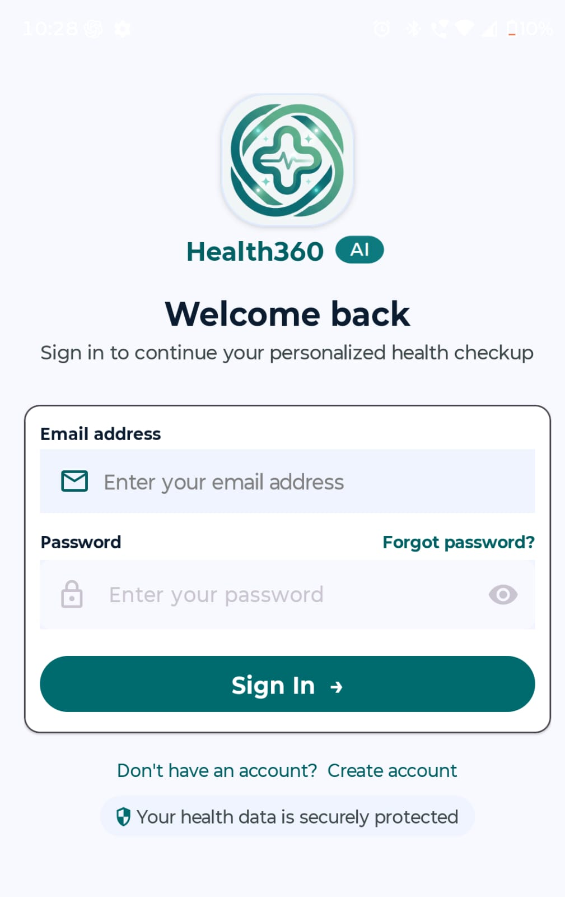
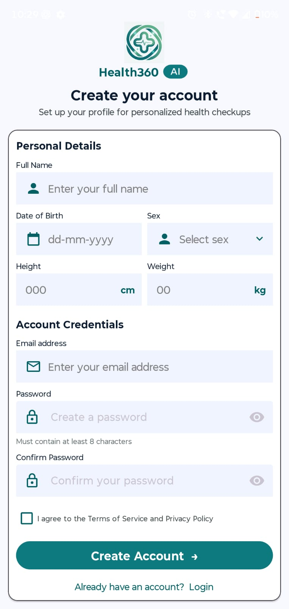
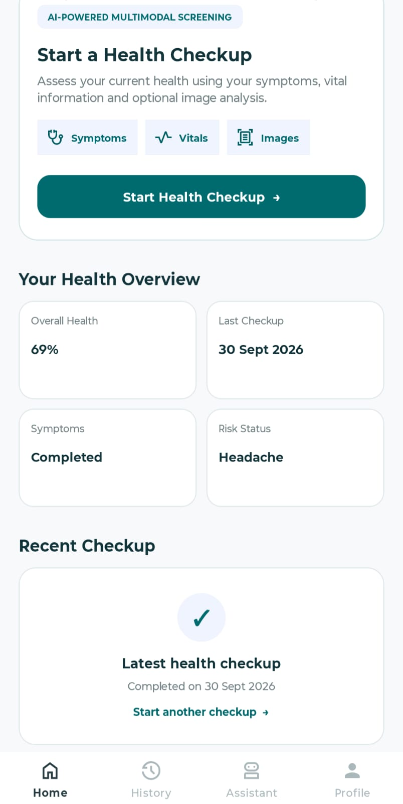
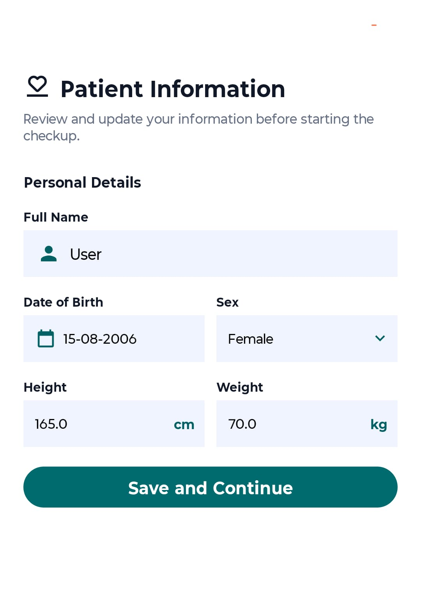
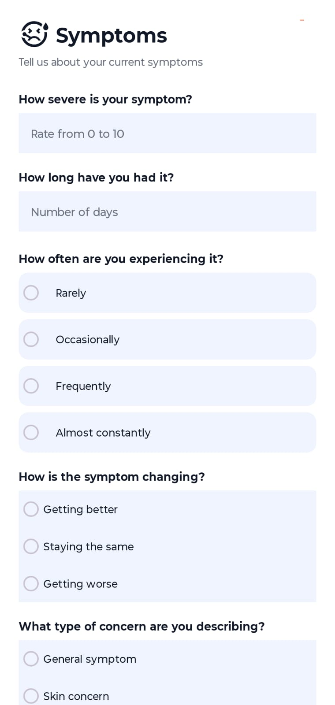
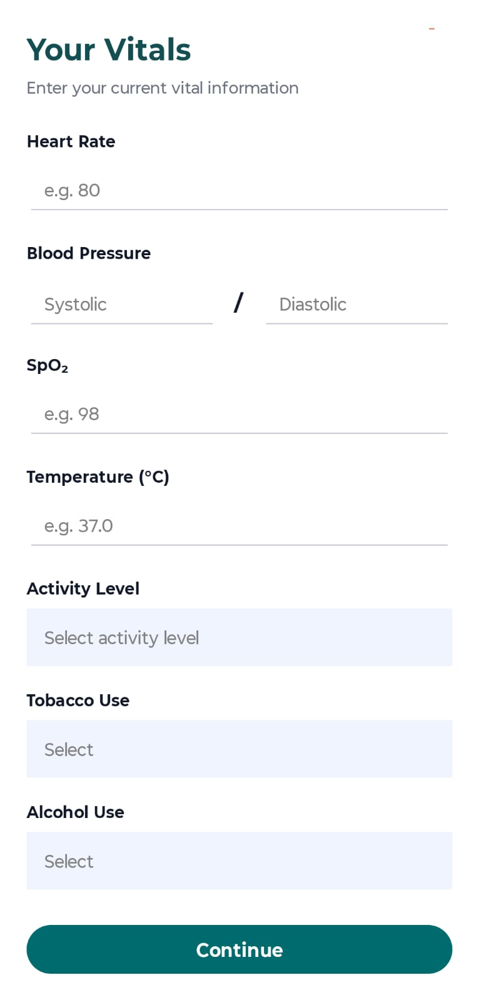
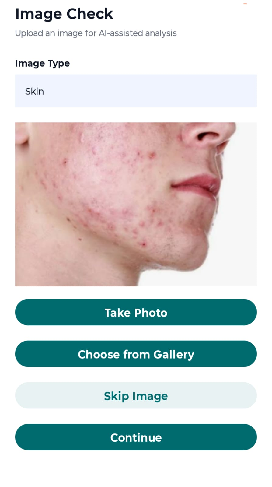
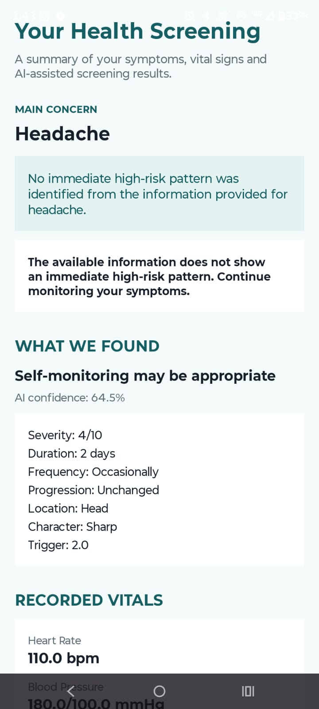
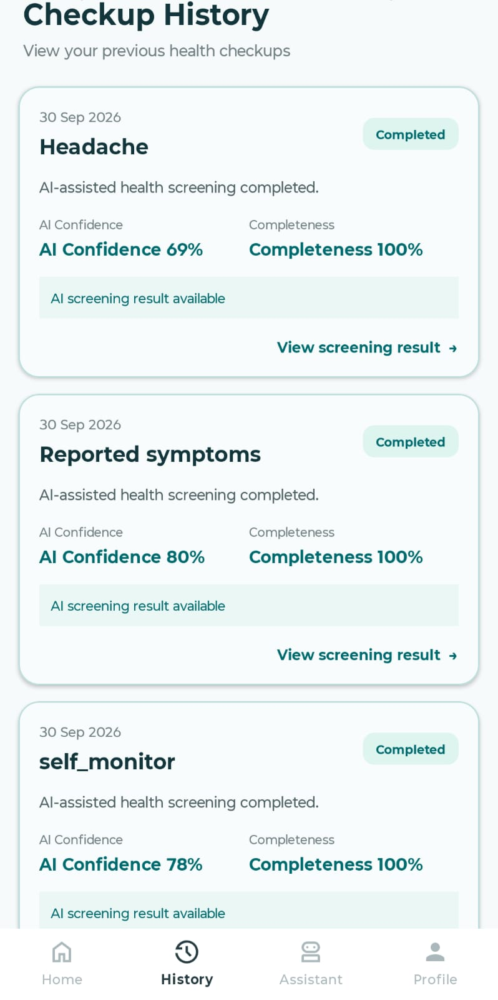
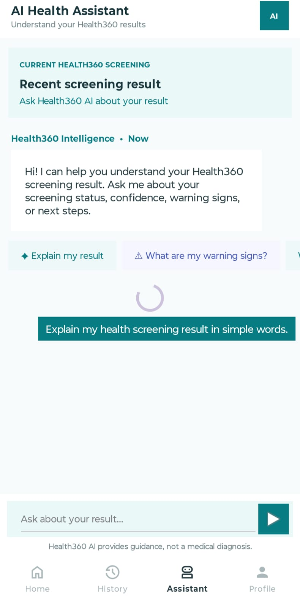

<div align="center">

# Health360 AI

### Modular Multimodal AI-Powered Personal Health Screening Platform


</div>

> **Disclaimer:** Health360 AI is an AI-assisted screening and health-awareness prototype. It is **not** a clinically validated diagnostic system and is not intended to replace qualified healthcare professionals.

---

## Table of Contents

1. [Overview](#1-overview)
2. [Objectives](#2-objectives)
3. [System Architecture](#3-system-architecture)
4. [AI Pipeline](#4-ai-pipeline)
5. [Image Preprocessing](#5-image-preprocessing)
6. [Vision Models](#6-vision-models)
7. [Symptom Model](#7-symptom-model)
8. [Patient and Vitals Model](#8-patient-and-vitals-model)
9. [Multimodal Fusion](#9-multimodal-fusion)
10. [Confidence and Uncertainty](#10-confidence-and-uncertainty)
11. [Screening Result](#11-screening-result)
12. [Backend](#12-backend)
13. [Supabase](#13-supabase)
14. [Authentication and Password Recovery](#14-authentication-and-password-recovery)
15. [AI Health Assistant](#15-ai-health-assistant)
16. [Android Application](#16-android-application)
17. [Application Workflow](#17-application-workflow)
18. [Technology Stack](#18-technology-stack)
19. [Project Structure](#19-project-structure)
20. [API Reference](#20-api-reference)
21. [Installation](#21-installation)
22. [Testing](#22-testing)
23. [Security](#23-security)
24. [Limitations](#24-limitations)
25. [Future Work](#25-future-work)
26. [Screenshots](#26-screenshots)
27. [Disclaimer](#27-disclaimer)
28. [Repository](#28-repository)

---

## 1. Overview

Health360 AI explores a multimodal approach to personal health screening. Instead of processing symptoms, patient information, numerical measurements, and images independently, the system converts each available modality into a structured representation and combines them through a learned fusion layer.

The platform consists of an **Android client**, a **FastAPI backend**, **AI processing modules**, **Supabase persistence**, and an **AI health assistant**.

```
Android Application
        |
        +---- Patient Information
        +---- Symptoms
        +---- Vitals
        +---- Image Input
                    |
                    +---- Skin
                    +---- Oral
                    +---- Wound
        |
        v
FastAPI Backend
        |
        v
AI Processing Pipeline
        |
        +---- Vision Models
        +---- Symptom Model
        +---- Patient/Vitals Model
        +---- Multimodal Fusion
        +---- Uncertainty
        |
        v
Structured Screening Result
        |
        +---- Supabase
        |
        +---- AI Health Assistant
```

## 2. Objectives

- Provide a unified mobile screening workflow.
- Combine heterogeneous health-related inputs.
- Use specialized models for different modalities.
- Support complaint-dependent image analysis.
- Combine modality-specific representations using multimodal fusion.
- Estimate confidence, uncertainty, completeness, and image quality.
- Persist screening results for historical access.
- Provide natural-language explanation of stored screening results.
- Keep AI-assisted screening separate from definitive medical diagnosis.

## 3. System Architecture

Health360 AI is organized into five logical layers.

| Layer | Responsibility |
|---|---|
| **Mobile** | Authentication, data collection, image input, result presentation, history, profile, and assistant UI |
| **API** | FastAPI interface between the Android app, AI pipeline, and persistence services |
| **AI** | Preprocessing, vision, symptom, patient, fusion, and uncertainty components |
| **Persistence** | Supabase Auth and PostgreSQL-backed screening records |
| **Explanation** | AI assistant that explains structured results, constrained to the supplied context |

## 4. AI Pipeline

```
Patient Information + Vitals
            |
            v
      Patient Risk Model
            |
            |
Symptoms --> Symptom Model
            |
            |
Images ----> Image Preprocessing
            |
       +----+----+----+
       |         |    |
       v         v    v
      Skin      Oral Wound
      Model     Model Model
       |         |    |
       +---------+----+
                 |
                 v
        Multimodal Fusion
            Gated MLP
                 |
                 v
           Health Vector
                 |
                 v
      Confidence / Uncertainty
                 |
                 v
        Screening Result
                 |
        +--------+--------+
        |                 |
        v                 v
    Supabase        AI Assistant
```

The architecture is modular: any individual model can be improved or replaced without redesigning the Android application.

## 5. Image Preprocessing

The preprocessing pipeline performs input validation, image quality checking, resizing, normalization, and tensor conversion. Image quality is treated as an explicit input characteristic rather than assuming every uploaded image is suitable for inference.

Verified output tensor shape: `1 × 3 × 224 × 224`

## 6. Vision Models

### Skin
Produces a learned visual representation for the fusion layer.
- **Fusion representation:** 1280-dimensional embedding

### Oral
- **Architecture:** ResNet18
- **Classes:** 4
- **Embedding:** 512 dimensions

```
Image → ResNet18 ─┬─ Classification
                  └─ 512-dimensional Embedding
```

### Wound
Combines segmentation and classification using **U-Net + EfficientNet-B3**.

| Output | Shape |
|---|---|
| Segmentation | `1 × 1 × 224 × 224` |
| Classification | `1 × 8` |
| Embedding | 384 dimensions |

The segmentation branch preserves spatial information, while the classification branch provides category-level information.

## 7. Symptom Model

Symptoms are collected through a structured questionnaire and processed with **XGBoost** (10 features).

```
Questionnaire → Structured Features → XGBoost → Symptom Representation
```

This modality works independently of image analysis, so screening sessions do not require an image.

## 8. Patient and Vitals Model

Patient information and vitals are converted into **25 structured features** for the patient risk component. The resulting representation feeds the fusion layer and provides context not necessarily visible in an image.

## 9. Multimodal Fusion

The fusion layer is a **gated MLP**.

| Modality | Dimensions |
|---|---|
| Skin | 1280 |
| Oral | 512 |
| Wound | 384 |
| Symptoms | 10 |
| Patient | 25 |
| Modality Mask | 5 |

The modality mask flags which modalities are available in a session, letting the system distinguish *missing* modalities from *processed* ones:

```
Skin      -> Available
Oral      -> Not provided
Wound     -> Not provided
Symptoms  -> Available
Patient   -> Available
```

The fusion layer outputs a shared health representation used by the result and uncertainty stages.

## 10. Confidence and Uncertainty

A dedicated uncertainty component produces outputs such as:

```json
{
  "confidence": 0.90,
  "uncertainty": 0.31,
  "completeness": 1.0,
  "image_quality": 1.0
}
```

These values describe the AI pipeline and its inputs. They are **not** clinical certainty.

```
Model confidence   !=  Clinical certainty
Input completeness !=  Guaranteed correctness
```

## 11. Screening Result

Each completed screening is stored as a structured record:

`user_id` · `status` · `overall_score` · `overall_category` · `confidence` · `uncertainty` · `completeness` · `symptoms` · `patient_data` · `image_result` · `symptom_result` · `patient_result` · `fusion_result` · `screening` · `uncertainty_data` · `created_at`

The same record powers the Android result screen, the history screen, and the AI assistant.

## 12. Backend

The FastAPI backend is organized around routers, schemas, and services.

```
backend/
├── main.py
├── routers/
│   ├── checkups.py
│   └── assistant.py
├── schemas/
└── services/
    ├── assistant_service.py
    └── supabase_service.py
```

It provides API boundaries, request processing, AI orchestration, persistence, checkup retrieval, and assistant context retrieval, so the Android client never manages model internals.

## 13. Supabase

Supabase provides authentication (accounts and sessions) and PostgreSQL storage for completed screenings tied to the authenticated user. The backend can fetch the latest checkup or a specific checkup by ID for the assistant.

## 14. Authentication and Password Recovery

The app supports registration, login, persistent sessions, and password recovery via a native Android deep link:

```
health360://login/reset
```

```
Forgot Password → Supabase sends email → User opens reset link
→ Android deep link → Reset Password Activity
→ Supabase recovery session → New password
```

Recovery is handled in a separate activity so a recovery session is never treated as a normal authenticated login.

## 15. AI Health Assistant

The assistant operates on stored screening context. It is designed to:

- Explain screening results, confidence, and uncertainty.
- Explain warning information contained in the result.
- Use the available structured context.
- Avoid inventing missing information.
- Avoid presenting screening output as a definitive diagnosis.

It is an explanation layer over the structured system, not a replacement for the AI pipeline.

## 16. Android Application

Built with **Kotlin** and **XML-based Android Views**; networking uses **Retrofit** and **OkHttp**.

Major areas: Authentication · Home · Patient Information · Symptoms · Vitals · Image Input · Screening Result · History · AI Assistant · Profile

## 17. Application Workflow

```
Authentication → Home → Patient Information → Symptoms → Vitals
      → Image Input → AI Screening → Result ─┬─> History
                                              └─> AI Assistant
```

The image stage is complaint-dependent; not every image modality is required for every session.

## 18. Technology Stack

| Layer | Technology |
|---|---|
| Mobile | Android |
| Language | Kotlin |
| UI | XML / Android Views |
| Networking | Retrofit, OkHttp |
| Backend | FastAPI |
| AI / ML | Python |
| Deep Learning | PyTorch |
| Computer Vision | OpenCV, Torchvision |
| Oral Model | ResNet18 |
| Wound Model | U-Net + EfficientNet-B3 |
| Tabular Model | XGBoost |
| Fusion | Gated MLP |
| Authentication | Supabase Auth |
| Database | Supabase PostgreSQL |
| AI Assistant | Groq |
| API Testing | Postman |
| Version Control | Git / GitHub |

## 19. Project Structure

```
Health360-AI/
├── android/
│   └── Health360AI/
│       ├── app/
│       ├── gradle/
│       ├── build.gradle.kts
│       └── settings.gradle.kts
├── backend/
│   ├── main.py
│   ├── routers/
│   ├── schemas/
│   └── services/
├── ai/
│   ├── preprocessing/
│   ├── vision/
│   ├── symptoms/
│   ├── patient/
│   ├── fusion/
│   └── uncertainty/
├── docs/
│   └── screenshots/
├── requirements.txt
├── .gitignore
└── README.md
```

## 20. API Reference

### Health Check

`GET /health`

```json
{ "status": "healthy" }
```

### AI Assistant

`POST /api/v1/assistant/chat`

**Request**
```json
{
  "user_id": "USER_ID",
  "message": "What does my confidence mean?",
  "checkup_id": "CHECKUP_ID"
}
```

**Response**
```json
{
  "status": "completed",
  "message": "Assistant response",
  "context": {}
}
```

Additional screening endpoints handle checkup processing and persistence.

## 21. Installation

### Requirements

- Android Studio
- JDK
- Python
- Git
- Supabase project
- Groq API access

### Clone

```bash
git clone https://github.com/saadhana252007/Health360_AI.git
cd Health360_AI
```

### Backend Environment

```bash
python -m venv .venv
```

Activate it:

```bash
# Windows
.venv\Scripts\activate

# macOS / Linux
source .venv/bin/activate
```

Install dependencies:

```bash
pip install -r requirements.txt
```

### Environment Variables

Create a local `.env` file (**never commit it**):

```env
SUPABASE_URL=your_supabase_url
SUPABASE_SECRET_KEY=your_supabase_secret_key
GROQ_API_KEY=your_groq_api_key
```

### Start Backend

```bash
uvicorn backend.main:app --host 0.0.0.0 --port 8000
```

The API is available on port `8000`.

### Android

1. Open `android/Health360AI` in Android Studio.
2. Configure the development backend address and the client-safe (publishable) configuration.
3. Run on an emulator or physical device.

## 22. Testing

### AI Pipeline

Modules were tested for image quality checking, preprocessing, oral inference, wound segmentation and classification, symptom inference, patient feature processing, multimodal fusion, and uncertainty estimation.

| Check | Verified Shape |
|---|---|
| Image tensor | `1 × 3 × 224 × 224` |
| Oral embedding | `1 × 512` |
| Wound segmentation | `1 × 1 × 224 × 224` |
| Wound class | `1 × 8` |
| Wound embedding | `1 × 384` |

### Backend

Tested via API requests and Postman: health endpoint, checkup processing, database persistence, Supabase integration, and the AI assistant endpoint.

### Android

Main workflow tested across Login, Registration, Home, Patient Information, Symptoms, Vitals, Image Input, Result, History, Assistant, and Profile.

## 23. Security

Sensitive values are intentionally kept outside the repository. **Never commit:**

- `.env`
- `local.properties`
- Supabase secret keys
- Groq API keys
- Android signing keys and keystores
- Passwords

The backend owns server-side credentials; the Android app uses only client-safe configuration.

## 24. Limitations

Health360 AI is an engineering and research prototype.

- Current AI models require broader evaluation.
- Performance depends on training data quality and distribution.
- Image modules cover a limited set of health-related categories.
- Confidence and uncertainty are model-level indicators, not clinical certainty.
- Further evaluation across larger, more diverse populations is required.
- Production deployment needs additional security, monitoring, privacy, scalability, and compliance work.
- It must not be used as a substitute for professional medical evaluation.

## 25. Future Work

**AI**
- Larger and more diverse datasets
- Improved calibration and uncertainty estimation
- Additional image modalities
- Improved multimodal fusion
- More comprehensive evaluation

**Application**
- Longitudinal health trends
- Enhanced result visualization
- Improved accessibility
- Offline support for selected features
- More detailed historical analysis

**Infrastructure**
- Production deployment and dedicated model serving
- Monitoring and observability
- Scalable inference
- Automated evaluation
- Enhanced security and privacy controls

**Explainability**
- Expose available and missing modalities
- Expose input quality
- Show contribution of individual model outputs
- Show factors affecting uncertainty

## 26. Screenshots

<!--
HOW TO ADD SCREENSHOTS:
1. Save each image inside docs/screenshots/ using the exact file names below.
2. Commit and push. GitHub will render them automatically.
3. To add a new image, use:  
-->

### Authentication

<p align="center">
  
  &nbsp;&nbsp;
  
</p>
<p align="center"><em>Login &nbsp;|&nbsp; Registration</em></p>

### Screening Input Flow

<p align="center">
  
  &nbsp;
  
  &nbsp;
  
</p>
<p align="center"><em>Home &nbsp;|&nbsp; Patient Information &nbsp;|&nbsp; Symptoms</em></p>

<p align="center">
  
  &nbsp;
  
</p>
<p align="center"><em>Vitals &nbsp;|&nbsp; Image Input</em></p>

### Results and Assistant

<p align="center">
  
  &nbsp;
  
  &nbsp;
  
</p>
<p align="center"><em>Result &nbsp;|&nbsp; History &nbsp;|&nbsp; AI Assistant</em></p>

> **Required files** in `docs/screenshots/`: `login.png`, `register.png`, `home.png`, `patient_information.png`, `symptoms.png`, `vitals.png`, `image_input.png`, `result.png`, `history.png`, `assistant.png`

## 27. Disclaimer

Health360 AI is an AI-assisted health screening and health-awareness prototype. It is not intended to provide definitive medical diagnosis, prescribe medication, determine treatment independently, replace qualified healthcare professionals, or replace emergency medical services.

AI-generated outputs may contain errors or uncertainty. Consult an appropriately qualified healthcare professional for medical concerns, diagnosis, treatment decisions, or urgent symptoms.

## 28. Repository

GitHub: <https://github.com/saadhana252007/Health360_AI>

The repository contains the integrated Android application, FastAPI backend, AI modules, Supabase integration, and AI health assistant.

### Project Status

```
Android → FastAPI → AI Pipeline → Multimodal Fusion
        → Uncertainty → Supabase → AI Health Assistant
```

The project is a modular research and engineering prototype intended to support continued development, evaluation, and extension of multimodal AI-assisted health screening.
